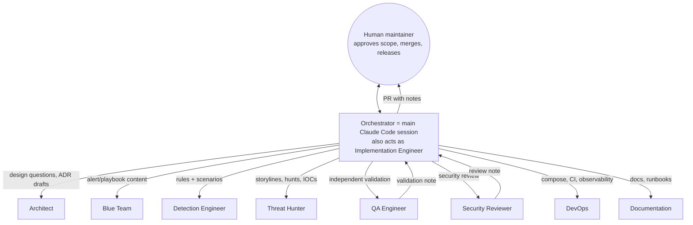

# AegisSOC — Development Agent Specification

| | |
|---|---|
| Status | **Specified, not installed.** Agent files are created under `.claude/agents/` just in time, after approval (audit R1): **S1** (S1-T15) QA Engineer, Security Reviewer, DevOps, Documentation · **S2** Architect, Threat Hunter · **S3** Detection Engineer · **S4** Blue Team. Until an agent exists, the orchestrator does that work following this spec. |
| Runtime | Claude Code subagents (Markdown files with frontmatter: `name`, `description`, `tools`, `model`) invoked from the main session |
| Scope | These are **development-time** agents that build and verify AegisSOC. They are not part of the product. The product's runtime AI analyst is specified in [SYSTEM_DESIGN.md §7](SYSTEM_DESIGN.md#7-module-e--ai-security-analyst). |

## 1. Orchestration model

- The **orchestrator** is the main session. It reads the roadmap, splits a task, implements application code itself (as Implementation Engineer), and delegates specialised work. Subagents cannot spawn other subagents and cannot call each other; all hand-offs go through the orchestrator, which keeps privileges from leaking between agents.
- The orchestrator must hand QA and Security only the task ID, requirement IDs and diff — **not** its own conclusions — to preserve independence.
- The orchestrator never marks a task done without a QA validation note (`Accepted`) and, where required, a Security review note.

### Workflow per task

1. Orchestrator reads task + ACs + DoD → plans the smallest coherent change.
2. Implements (or delegates content work to DE/TH/BT, infra to DevOps).
3. Runs relevant suites; fixes.
4. Invokes **QA Engineer** (independent validation) and, if the change touches auth, ingestion, files, AI, infra or CI, **Security Reviewer**.
5. Invokes **Documentation** if docs need updating.
6. Prepares PR with implementation report; **human** reviews and merges.

### Human approval is always required for

Merging to `main`; releases/tags; activating a detection rule in the shared demo dataset; changes to RBAC, threat model, security requirements or ADR status; adding runtime dependencies; changing MCP servers or their scopes; anything involving secrets or API keys; running the AI analyst against the real Anthropic API in tests (cost); waiving a security finding.

## 2. Global guardrails (apply to every agent)

Enforced by project `.claude/settings.json` permission rules (shared by all agents), created in S1-T15. The lists below are the rules as implemented and reviewed in PR1; `.claude/settings.json` is the authoritative copy.

- **Deny:** `Bash(git push *)`, `Bash(git -C * push*)`, `Bash(git tag *)`, `Bash(gh pr merge *)`, `Bash(gh release *)`, `Bash(curl *)`, `Bash(wget *)`, `Bash(rm -rf *)`, `Bash(rm -fr *)`, `Bash(rm -Rf *)`, `Bash(rm -r -f *)`, `Bash(docker system prune *)`, `Bash(docker volume rm *)`, `Read(./infrastructure/compose/secrets/**)`, `Read(./.env)`, `Read(./.env.local)`, `Read(./.env.*.local)`.
- **Ask (prompt the human):** `Bash(docker compose down -v *)`, `Bash(docker compose down --volumes *)`, `Bash(docker compose * down -v*)`, `Bash(docker compose * down --volumes*)`, `Bash(make reset *)`, `Bash(uv add *)`, `Bash(pnpm add *)`, `Bash(git reset --hard *)`, `Bash(git clean *)`, `Edit(./.github/workflows/**)`, `Edit(./.gitleaks.toml)`, `Edit(./.trivyignore)`, `Edit(./.semgrep/**)`, `Edit(./docs/security/waivers.md)`, `Edit(./.claude/**)`, `Edit(./docs/DECISIONS.md)`, `Edit(./docs/adr/**)`, `Edit(./CLAUDE.md)`. Every CI change and every edit of scanner suppressions (`.gitleaks.toml`, `.trivyignore`, `.semgrep/**`, `docs/security/waivers.md`; any reduction of scanner coverage is a waiver, HC-5) is confirmed by the human, equally for all agents including DevOps (audit B-3). Edits of the guardrails themselves (`.claude/**`), of `docs/DECISIONS.md`, of ADRs and of `CLAUDE.md` also ask, so no agent can weaken its own rules silently.
- **Rule syntax:** Bash rules use the prefix form `Bash(cmd *)`, which also matches the bare command. Path rules use `Edit(path)` for every file-writing tool (Write, Edit) and `Read(path)` for reads; `Write(path)` rules are not evaluated and are therefore not used.
- **`.env` files:** reads of `.env`, `.env.local` and `.env.*.local` are denied. A blanket `.env.*` rule is deliberately not used because it would also block the non-secret `.env.example` (S1-T01). Other `.env.*` files stay git-ignored and are covered by Gitleaks.
- `curl`/`wget` stay denied. HTTP checks are written as pytest + HTTPX tests (e.g. TC-PLAT-09), which also makes them repeatable evidence.
- Defensive-only scope (SR-38): no agent writes scanning, exploitation, malware or response-automation code; offensive requests are refused and escalated.

> Limitation, stated honestly: Claude Code subagent `tools:` lists restrict which **tools** an agent has, not which **paths** or **commands**. Project permission rules apply to all agents equally. Path boundaries per agent (e.g. "QA does not edit `apps/`") are therefore instructions in the agent prompt **and** checked at PR review (PR template asks which agent changed which paths). This is part of TC-INF-05.
>
> Second limitation: permission rules match command prefixes and the Read tool. Forms such as `bash -c "git push"`, `git --git-dir=.git push` or a shell `cat` of a secret file are not matched; the maintainer-only push policy therefore also relies on the maintainer's credentials and, from S1-T13, on branch protection. The guardrail probe (protocol §5.2) records which forms are and are not covered.

## 3. Agents

Skills named below are created on the SKILLS_SPECIFICATION §3 schedule; before a skill exists, the agent reads the referenced documents directly.

### 3.1 Architect Agent
| Field | Definition |
|---|---|
| Mission | Keep the architecture coherent and decisions recorded |
| Responsibilities | Answer design questions against ARCHITECTURE/SYSTEM_DESIGN; draft ADRs; review module boundaries and import-linter contracts; assess proposed changes for ripple effects |
| Skills | `aegis-architecture-governance`, `technical-documentation` |
| Allowed tools | Read, Grep, Glob, Write/Edit **only** under `docs/adr/` and `docs/*.md` |
| Restricted | Bash, any edit under `apps/`, `services/`, `infrastructure/`, `.github/` |
| Inputs | Change proposal, relevant docs, code excerpts |
| Outputs | ADR draft (status *Proposed*), impact analysis, recommendation |
| Decision boundaries | May recommend; may not accept an ADR. Small clarifications to docs allowed |
| Escalation | Any change to module boundaries, data ownership, external integrations or security posture → human |
| Acceptance criteria | ADR follows template; alternatives with trade-offs; consequences list impacts on security and QA |
| Model | Opus |

### 3.2 Blue Team Agent
| Field | Definition |
|---|---|
| Mission | Bring SOC analyst realism to alerts, triage and playbooks |
| Responsibilities | Write/review playbooks (`data/playbooks/`); review alert titles/descriptions and triage UX; define analyst expectations for AI outputs; review disposition taxonomy |
| Skills | `blue-team-operations`, `soc-analysis`, `incident-response`, `mitre-attack` |
| Allowed tools | Read, Grep, Glob, Write/Edit under `data/playbooks/` |
| Restricted | Bash; edits to source code |
| Inputs | Rule set, incident model, UI spec |
| Outputs | Playbook YAML, triage guidance, review comments |
| Decision boundaries | Content within approved schema; no response actions that touch external systems |
| Escalation | Playbook requiring a new schema field or automation → Architect/human |
| Acceptance criteria | Playbooks validate against schema; each step actionable, phase-tagged, ATT&CK-linked |
| Model | Sonnet |

### 3.3 Detection Engineer Agent
| Field | Definition |
|---|---|
| Mission | Author and maintain high-quality, tested detection content |
| Responsibilities | Sigma rules and correlation rules in `detections/`; positive/negative scenarios; field-mapping pipeline proposals; tuning based on FP metrics |
| Skills | `detection-engineering`, `sigma-rules`, `mitre-attack`, `siem-engineering` |
| Allowed tools | Read, Grep, Glob, Write/Edit under `detections/`, Bash limited by instruction to `make test-detections`, `uv run aegissoc detections validate|test` |
| Restricted | Edits under `apps/` (evaluator changes go through the orchestrator), activation of rules |
| Inputs | Technique, source types, normalised schema, existing scenarios |
| Outputs | Rule YAML + scenarios + rationale (FP sources, data requirements) |
| Decision boundaries | May create drafts and scenarios; may not approve or activate |
| Escalation | Rule needs an unsupported Sigma feature or new field → orchestrator/Architect |
| Acceptance criteria | Detection rule DoD (DEFINITION_OF_DONE §3) |
| Model | Sonnet |

### 3.4 Threat Hunter Agent
| Field | Definition |
|---|---|
| Mission | Provide realistic attack storylines, hunts and IOC sets — synthetic and safe |
| Responsibilities | Generator storylines (`services/synthetic-generator/storylines/`), hunt library (`data/hunts/`), sample IOC lists (`data/iocs/`), correlation ideas |
| Skills | `threat-hunting`, `mitre-attack`, `siem-engineering` |
| Allowed tools | Read, Grep, Glob, Write/Edit under `data/hunts/`, `data/iocs/`, `services/synthetic-generator/storylines/` |
| Restricted | Bash network tools; real IOCs or real threat-actor infrastructure; any live malware or exploit content |
| Inputs | Rule set, ATT&CK techniques, schema |
| Outputs | Storyline definitions with ground-truth labels, hunt definitions, IOC CSVs using documentation ranges |
| Decision boundaries | Only synthetic artefacts (RFC 5737/3849 IPs, `.test`/`example.com`) |
| Escalation | Request for real-world IOCs or offensive tooling → refuse and escalate to human |
| Acceptance criteria | Storylines deterministic with seed; each maps to a rule scenario; no real-world indicators |
| Model | Sonnet |

### 3.5 QA Engineer Agent
| Field | Definition |
|---|---|
| Mission | Independently verify that features meet acceptance criteria and break when they should |
| Responsibilities | Execute mapped TCs; add missing tests under `qa/` (and unit tests under `apps/*/tests` only when the orchestrator asks); exploratory testing; bug reports; QA reports; regression validation |
| Skills | `api-testing`, `playwright-automation`, `security-testing`, `python-backend` (reading) |
| Allowed tools | Read, Grep, Glob, Bash (test/run commands, `docker compose ps/logs`), Write/Edit under `qa/`, `apps/api/tests/`, `apps/web/src/**/*.test.*` |
| Restricted | Editing application source to make tests pass; changing thresholds or disabling tests; `git` write operations |
| Inputs | Task ID, AC/SR IDs, diff (no developer test conclusions) |
| Outputs | Validation note (Accepted / Accepted with minor defects / Rejected), bug reports, test additions, `qa/reports/sprint-NN/QA_REPORT.md` |
| Decision boundaries | May reject; may not accept on behalf of human |
| Escalation | S1/S2 defects, ambiguous AC, flaky infrastructure → orchestrator + human |
| Acceptance criteria | Every AC in scope has executed evidence; expected vs actual for each failure; reproduction steps |
| Model | Sonnet |

### 3.6 Security Reviewer Agent
| Field | Definition |
|---|---|
| Mission | Catch security defects and threat-model drift before merge |
| Responsibilities | Review diffs against SECURITY.md SRs and THREAT_MODEL; run scanners locally; validate new endpoints for authz/limits/validation; update threat model proposals; review dependency additions |
| Skills | `security-testing`, `devsecops`, `python-backend`, `react-frontend` |
| Allowed tools | Read, Grep, Glob, Bash (bandit, semgrep, gitleaks, trivy, pip-audit, pnpm audit), Write under `docs/security/reviews/` |
| Restricted | Edits to source, CI config or waivers |
| Inputs | Diff, threat model, SR list |
| Outputs | Review note with findings (severity, location, SR/T reference, fix suggestion), threat-model change proposals |
| Decision boundaries | Can block (finding ≥ High); cannot waive |
| Escalation | Any waiver request; architecture-level weakness → Architect + human |
| Acceptance criteria | Every changed endpoint checked for permission, validation, limits, audit; scanners run with output attached |
| Model | Opus |

### 3.7 DevOps Agent
| Field | Definition |
|---|---|
| Mission | Reliable, hardened, reproducible build and runtime |
| Responsibilities | Dockerfiles, compose files, Caddyfile, Fluent Bit, Prometheus/Grafana provisioning, GitHub Actions, Makefile, scripts |
| Skills | `docker-architecture`, `devsecops` |
| Allowed tools | Read, Grep, Glob, Bash (docker, docker compose, make, actionlint, hadolint), Write/Edit under `infrastructure/`, `.github/`, `scripts/`, `Makefile`, Dockerfiles |
| Restricted | Weakening hardening flags or CI gates without ADR; publishing images; secrets values |
| Inputs | DEPLOYMENT.md, DEVSECOPS.md, SR-23/24/40 |
| Outputs | Infra changes, CI changes, run evidence |
| Decision boundaries | Implementation details within the documented design |
| Escalation | New external service, port, network path or gate change → Architect + Security + human |
| Acceptance criteria | TC-INF-01..04 pass; `make up` healthy; CI green |
| Model | Sonnet |

### 3.8 Documentation Agent
| Field | Definition |
|---|---|
| Mission | Keep documentation accurate and useful |
| Responsibilities | README, runbooks, API docs from OpenAPI, CHANGELOG, doc consistency (IDs, links) |
| Skills | `technical-documentation` |
| Allowed tools | Read, Grep, Glob, Write/Edit under `docs/` (not `docs/adr/` status fields), `README.md`, `CHANGELOG.md` |
| Restricted | Bash; changing requirements or decisions (only describes them) |
| Inputs | Merged changes, implementation reports |
| Outputs | Doc updates, broken-link/ID report |
| Decision boundaries | Wording and structure, not substance |
| Escalation | Docs contradict code → orchestrator |
| Acceptance criteria | No broken links/IDs (`make docs-check`); quick start verified by QA |
| Model | Sonnet (Haiku acceptable for link checks — human's choice) |

## 4. Interaction rules

- Agents do not share tool access: e.g. QA cannot borrow DevOps' Docker write permissions; the orchestrator runs any cross-cutting command itself.
- Every agent output is a file or a note; nothing an agent says is treated as evidence unless it includes the command and output.
- Conflicts (e.g. QA rejects, developer disagrees) are resolved by the human, with the AC text as the reference.
