# AegisSOC — Database Design

| | |
|---|---|
| Status | Planning baseline — architecture accepted via ADRs (D-06), Sprint 1 scope approved (D-08). Changes follow ADR-0001 |
| Engine | PostgreSQL 16 (single database `aegissoc`, schema `public`) |
| Access | SQLAlchemy 2.0 async + asyncpg; migrations with Alembic |
| Ownership rule | Each table is written only by its owning module (see [ARCHITECTURE.md §3.2](ARCHITECTURE.md#32-backend-modules-inside-aegissoc)) |

Common columns (omitted below unless they differ): `id uuid PK` (UUIDv7, generated in app), `created_at timestamptz NOT NULL DEFAULT now()`, `updated_at timestamptz NOT NULL DEFAULT now()` on mutable tables. `version int NOT NULL DEFAULT 1` on aggregates with optimistic locking.

Enumerations are PostgreSQL `text` with `CHECK` constraints (easier migrations than native enums).

---

## 1. Entity relationship diagram

```mermaid
erDiagram
  users ||--o{ audit_log : "actor"
  users ||--o{ api_keys : "created_by"
  log_sources ||--o{ api_keys : has
  log_sources ||--o{ ingest_batches : receives
  log_sources ||--o{ events : produces
  ingest_batches ||--o{ ingest_errors : has
  retention_policies ||--o{ log_sources : governs

  detection_rules ||--|{ detection_rule_versions : versions
  detection_rule_versions ||--o{ rule_techniques : tags
  mitre_techniques ||--o{ rule_techniques : tagged
  mitre_tactics ||--o{ mitre_technique_tactics : includes
  mitre_techniques ||--o{ mitre_technique_tactics : in
  detection_rules ||--o{ rule_test_scenarios : tested_by
  validation_runs ||--o{ validation_results : contains
  rule_test_scenarios ||--o{ validation_results : executed_as
  detection_rule_versions ||--o{ validation_results : against

  detection_rule_versions ||--o{ alerts : raises
  alerts ||--o{ alert_events : includes
  events ||--o{ alert_events : in
  alerts ||--o{ alert_links : "correlated from"
  users ||--o{ alerts : assignee

  incidents ||--o{ incident_alerts : groups
  alerts ||--o{ incident_alerts : in
  incidents ||--o{ incident_notes : has
  incidents ||--o{ evidence : has
  incidents ||--o{ incident_timeline : has
  incidents ||--o{ incident_playbook_steps : works
  playbooks ||--|{ playbook_steps : defines
  playbook_steps ||--o{ incident_playbook_steps : instantiated
  users ||--o{ incidents : assignee

  ioc_lists ||--o{ iocs : contains
  iocs ||--o{ ioc_matches : matched
  alerts ||--o{ ioc_matches : raised

  hunts ||--o{ hunt_runs : runs
  detection_rule_versions ||--o{ hunts : "retro-hunt with"

  ai_analyses ||--o{ ai_proposed_actions : proposes
  users ||--o{ ai_analyses : requested
```

## 2. Tables

### 2.1 Platform

**users**
| Column | Type | Constraints |
|---|---|---|
| username | citext | UNIQUE NOT NULL, 3–64 chars `[a-z0-9._-]` |
| display_name | text | NOT NULL |
| email | citext | UNIQUE NULL |
| password_hash | text | NOT NULL (argon2id PHC string) |
| role | text | CHECK in (`admin`,`detection_engineer`,`analyst`,`viewer`) |
| is_active | bool | NOT NULL DEFAULT true |
| last_failed_login_at | timestamptz | NULL — display only; login-throttle state lives in Redis (`auth:fail:*`, SYSTEM_DESIGN §2) |
| last_login_at | timestamptz | NULL |
| password_changed_at | timestamptz | NOT NULL |

**audit_log** (append-only; no `updated_at`)
| Column | Type | Notes |
|---|---|---|
| id | bigint identity PK | monotonic ordering |
| occurred_at | timestamptz | NOT NULL DEFAULT now() |
| actor_type | text | `user`, `api_key`, `system`, `ai_suggested_user` |
| actor_id | uuid | NULL for `system` |
| actor_label | text | username / key prefix snapshot |
| action | text | e.g. `auth.login.success`, `incident.transition` |
| target_type, target_id | text, text | |
| outcome | text | `success`, `denied`, `failure` |
| ip | inet | NULL |
| request_id | text | |
| details | jsonb | never contains secrets |

Immutability: `aegis_app` is granted only `SELECT, INSERT` (no UPDATE/DELETE/TRUNCATE). The row-level trigger `audit_log_immutable` (BEFORE UPDATE OR DELETE) and the statement-level trigger `audit_log_no_truncate` (BEFORE TRUNCATE) raise unless `current_user = 'aegis_owner'`. The only sanctioned deletion path is `aegis_purge_audit_before(cutoff)` (§6). No session variable or setting can switch the protection off.

**api_keys**
| Column | Type | Notes |
|---|---|---|
| key_id | text | UNIQUE NOT NULL (12 chars, public) |
| secret_hash | bytea | NOT NULL (sha256 of secret) |
| prefix | text | display `aik_<key_id>_…` |
| source_id | uuid FK log_sources | NOT NULL |
| created_by | uuid FK users | |
| expires_at, revoked_at, last_used_at | timestamptz | NULL |

### 2.2 SIEM

**retention_policies** — `name text UNIQUE` (`default`,`short`,`long`), `events_days int`, `description`.

**log_sources**
| Column | Type | Notes |
|---|---|---|
| name | text | UNIQUE |
| source_type | text | CHECK in parser registry list |
| environment | text | e.g. `demo` |
| data_origin | text | CHECK in (`synthetic`,`lab`) — `production` intentionally not allowed |
| retention_policy_id | uuid FK | |
| expected_eps | int | for silence detection |
| rate_limit_rps | int | DEFAULT 50 |
| is_enabled | bool | |

**ingest_batches**
| Column | Type | Notes |
|---|---|---|
| source_id | uuid FK | |
| api_key_id | uuid FK | |
| received_at | timestamptz | |
| record_count, accepted_count, failed_count | int | |
| status | text | `queued`,`processing`,`processed`,`failed` |
| processed_at | timestamptz | |

**events** — `PARTITION BY RANGE (event_time)`, daily partitions `events_pYYYYMMDD`.
| Column | Type | Notes |
|---|---|---|
| id | uuid | |
| event_time | timestamptz | NOT NULL — partition key |
| ingested_at | timestamptz | NOT NULL |
| source_id | uuid | NOT NULL (no FK on partitioned table for insert speed; validated in app) |
| batch_id | uuid | |
| dedup_key | bytea | sha256(source_id ‖ raw_hash) — identical re-sent records collapse |
| event_kind | text | |
| event_category | text[] | |
| event_action, event_outcome, event_code | text | |
| host_name, user_name, process_name | text | |
| source_ip, destination_ip | inet | |
| message | text | |
| message_tsv | tsvector | GENERATED ALWAYS AS (to_tsvector('simple', coalesce(message,''))) STORED |
| doc | jsonb | NOT NULL — full normalised ECS document |
| raw_hash | bytea | |
| PRIMARY KEY | (event_time, id) | |
| UNIQUE | (event_time, source_id, dedup_key) | |

> Dedup scope: the unique constraint is per partition (includes `event_time`), so a record re-sent with an identical timestamp is deduplicated; this is sufficient for at-least-once redelivery, which re-sends identical records.

**ingest_errors** — `batch_id`, `source_id`, `record_index int`, `stage text` (`envelope`,`parse`,`normalize`,`store`), `error_code`, `error_message`, `raw_excerpt text` (≤ 8 KiB, C1 patterns redacted), `occurred_at`.

### 2.3 Detection

**detection_rules**
| Column | Type | Notes |
|---|---|---|
| sigma_id | uuid | UNIQUE — Sigma `id` |
| kind | text | `sigma`, `correlation`, `builtin_ioc` |
| title | text | |
| status | text | `draft`,`validated`,`tested`,`approved`,`active`,`disabled`,`deprecated` (status of latest/active version, denormalised) |
| active_version_id | uuid FK detection_rule_versions | NULL |
| owner_id | uuid FK users | |
| disabled_reason | text | |
| version | int | optimistic lock |

**detection_rule_versions** (immutable except lifecycle columns)
| Column | Type | Notes |
|---|---|---|
| rule_id | uuid FK | |
| version_number | int | UNIQUE (rule_id, version_number) |
| content | text | Sigma YAML |
| content_sha256 | bytea | UNIQUE (rule_id, content_sha256) |
| level | text | |
| logsource | jsonb | |
| parsed | jsonb | normalised metadata |
| state | text | `draft`,`validated`,`tested`,`approved`,`active`,`superseded`,`rejected` |
| validation_findings | jsonb | |
| last_validation_run_id | uuid FK validation_runs | |
| author_id | uuid FK users | |
| approved_by | uuid FK users | CHECK approved_by <> author_id |
| approved_at, activated_at | timestamptz | |
| origin | text | `ui`, `repo_sync`, `import` |

**rule_techniques** — PK `(rule_version_id, technique_id)`.

**mitre_tactics** — `attack_id text UNIQUE` (TA0001), `name`, `shortname`, `attack_version text`.
**mitre_techniques** — `attack_id text UNIQUE` (T1059.001), `name`, `parent_attack_id text NULL`, `is_subtechnique bool`, `deprecated bool`, `revoked bool`, `description text`, `url text`, `attack_version text`.
**mitre_technique_tactics** — PK `(technique_id, tactic_id)`.

### 2.4 Alerts

**alerts**
| Column | Type | Notes |
|---|---|---|
| display_id | bigint identity | `ALR-<n>` |
| rule_id | uuid FK | |
| rule_version_id | uuid FK | |
| dedup_key | bytea | |
| title | text | |
| severity | text | `info`,`low`,`medium`,`high`,`critical` |
| status | text | `new`,`triaging`,`escalated`,`closed` |
| disposition | text | NULL or `true_positive`,`false_positive`,`benign_true_positive`,`duplicate` |
| assignee_id | uuid FK users | |
| first_event_time, last_event_time | timestamptz | |
| event_count | int | |
| group_values | jsonb | correlation/dedup group fields |
| entities | jsonb | `{hosts:[], users:[], ips:[]}` for pivots |
| data_origin | text | inherited from sources |
| closed_at | timestamptz | |
| version | int | |

**alert_events** — PK `(alert_id, event_id)`, `event_time timestamptz` (to locate partition).
**alert_links** — PK `(alert_id, source_alert_id)` — correlated alert → contributing alerts.

### 2.5 Incidents

**incidents**
| Column | Type | Notes |
|---|---|---|
| display_id | bigint identity | `INC-<n>` |
| title, description | text | |
| severity | text | `low`..`critical` |
| priority | text | `P1`..`P4` |
| classification | text | see SYSTEM_DESIGN §5.2 |
| status | text | state machine |
| resolution | text | NULL until closed |
| assignee_id | uuid FK users | |
| created_by | uuid FK users | |
| opened_at, closed_at | timestamptz | |
| time_to_triage_s, time_to_close_s | int | computed on transition |
| version | int | |

**incident_alerts** — PK `(incident_id, alert_id)`, `linked_by`, `linked_at`.
**incident_notes** — `incident_id`, `author_id`, `body text (≤ 20k)`, `revision int`, `supersedes_id uuid NULL`, `deleted_at`.
**evidence** — `incident_id`, `kind` (`event_ref`,`alert_ref`,`hunt_run_ref`,`file`), `ref_id`, `snapshot jsonb`, `filename`, `content_type`, `size_bytes`, `sha256 bytea`, `storage_path`, `uploaded_by`, `description`.
**incident_timeline** — `incident_id`, `occurred_at`, `entry_type` (`status_change`,`assignment`,`note`,`evidence`,`alert_linked`,`playbook_step`,`ai_analysis`,`field_change`), `actor_id`, `ai_suggested bool`, `payload jsonb`.
**playbooks** — `slug UNIQUE`, `title`, `applies_to jsonb`, `content_sha256`, `version`.
**playbook_steps** — `playbook_id`, `position`, `phase`, `title`, `description`, `required bool`.
**incident_playbook_steps** — `incident_id`, `playbook_step_id`, `status` (`todo`,`done`,`skipped`), `completed_by`, `completed_at`, `comment`.

### 2.6 Threat intel and hunting

**ioc_lists** — `name UNIQUE`, `source` (`manual`,`csv`,`stix`,`misp`), `tlp` (`clear`,`green`,`amber`,`red`), `default_ttl_days`, `is_enabled`.
**iocs** — `list_id`, `ioc_type`, `value text`, `value_normalized text`, `description`, `first_seen`, `expires_at`, UNIQUE `(list_id, ioc_type, value_normalized)`.
**ioc_matches** — `ioc_id`, `event_id`, `event_time`, `alert_id`, `matched_field`, `matched_at`.
**hunts** — `name`, `hypothesis`, `techniques text[]`, `query jsonb NULL`, `rule_version_id uuid NULL`, CHECK exactly one of query / rule_version_id, `owner_id`.
**hunt_runs** — `hunt_id`, `executed_by`, `parameters jsonb`, `status`, `row_count`, `duration_ms`, `results_snapshot jsonb (≤ 200 rows)`, `conclusion text`, `started_at`, `finished_at`.

### 2.7 AI

**ai_analyses**
| Column | Type | Notes |
|---|---|---|
| task | text | `explain`,`summarize`,`next_steps`,`explain_rule`,`report`,`attack_suggest`,`evidence_gaps` |
| target_type, target_id | text, uuid | |
| requested_by | uuid FK users | |
| status | text | `queued`,`running`,`completed`,`rejected`,`refused`,`failed` |
| provider, model | text | |
| prompt_version | text | hash of system prompt file |
| context_manifest | jsonb | IDs + field names sent (not values) |
| result | jsonb | validated envelope |
| validation | jsonb | dropped findings, reasons |
| input_tokens, output_tokens | int | |
| error | text | |
| started_at, finished_at | timestamptz | |

**ai_proposed_actions** — `analysis_id`, `action_key` (A1…), `type`, `params jsonb`, `rationale`, `citations jsonb`, `status` (`pending`,`applied`,`dismissed`,`expired`), `decided_by`, `decided_at`.

### 2.8 QA

**rule_test_scenarios** — `scenario_uuid UNIQUE`, `rule_id`, `name`, `kind` (`positive`,`negative`), `source_type`, `input_mode`, `content text` (YAML), `content_sha256`, `tags text[]`, `origin`.
**validation_runs** — `scope` (`rule_version`,`rule`,`all_active`,`regression`), `scope_ref uuid NULL`, `trigger` (`ui`,`ci`,`activation`,`schedule`), `triggered_by`, `status`, `passed`, `failed`, `errors`, `duration_ms`, `git_sha text NULL`, `started_at`, `finished_at`.
**validation_results** — `run_id`, `scenario_id`, `rule_version_id`, `outcome` (`passed`,`failed`,`error`), `expected jsonb`, `actual jsonb`, `diff jsonb`, `duration_ms`.

## 3. Indexing strategy

| Table | Index | Purpose |
|---|---|---|
| events (per partition, via partitioned index) | `btree (event_time DESC)` | time-range scans |
| | `btree (source_id, event_time DESC)` | per-source views, health |
| | `btree (host_name, event_time DESC)`, `(user_name, event_time DESC)` | entity timelines |
| | `gist (source_ip inet_ops)`, `gist (destination_ip inet_ops)` | CIDR queries |
| | `btree (event_code)`, `gin (event_category)` | filters |
| | `gin (message_tsv)` | full-text |
| | `gin (doc jsonb_path_ops)` | containment queries on non-hot fields |
| alerts | `(status, severity, created_at DESC)`, `(rule_id, created_at DESC)`, `(assignee_id) WHERE status <> 'closed'`, partial unique `(rule_id, dedup_key) WHERE status <> 'closed'` | queue views, dedup |
| incidents | `(status, priority, opened_at DESC)`, `(assignee_id) WHERE status <> 'closed'` | |
| audit_log | `(occurred_at DESC)`, `(actor_id, occurred_at DESC)`, `(target_type, target_id)` | |
| iocs | `(ioc_type, value_normalized)` | lookups |
| detection_rule_versions | `(rule_id, version_number DESC)` | |
| validation_results | `(run_id)`, `(rule_version_id, created_at DESC)` | |
| ai_analyses | `(target_type, target_id, created_at DESC)`, `(requested_by, created_at DESC)` | |

Indexes are added by migration with `CREATE INDEX CONCURRENTLY` once tables hold data (post-Sprint 2 migrations).

## 4. Data retention strategy

Authoritative values: [SYSTEM_DESIGN.md §3.7](SYSTEM_DESIGN.md#37-retention). Mechanism:
- Events: drop whole daily partitions (O(1), no vacuum debt); per-class row deletes for shorter classes.
- Other tables: batched `DELETE … WHERE created_at < cutoff LIMIT 5000` loops.
- Evidence files removed when their incident passes retention (reference counted by sha256).
- All retention runs audited (counts per table).

## 5. Migration strategy

- Alembic, one linear history, migrations reviewed like code. Naming `YYYYMMDD_HHMM_<slug>.py`.
- Every migration has `upgrade` and `downgrade`; downgrade tested in CI (`upgrade head → downgrade -1 → upgrade head`) on an empty DB.
- Partitions are not managed by Alembic: the parent table is. Partitions are created by the scheduler and a worker startup hook calling `aegis_ensure_event_partitions(7)` (today −1 … +7 days) and dropped by `aegis_drop_event_partitions_before(date)` — both owner functions in §6, created by the Sprint 2 migration.
- Expand/contract for breaking changes (add column → backfill → switch reads → drop old) — relevant once data must survive upgrades (after v0.1.0).
- Seed data (roles are code, not data; ATT&CK, playbooks, demo users) loaded by idempotent CLI commands, not migrations.

## 6. Database roles

| Role | Privileges | Used by |
|---|---|---|
| `postgres` (superuser) | bootstrap only | Postgres init script (creates roles and database); never used by the app or migrations |
| `aegis_owner` | owns the database, schema `public`, all tables, sequences and functions; runs migrations | `migrate` job only — api/worker never receive its password |
| `aegis_app` | SELECT/INSERT/UPDATE/DELETE on module tables; **SELECT, INSERT only on `audit_log`**; USAGE on sequences; EXECUTE on the owner functions below; no DDL, no TRUNCATE | api, worker |
| `aegis_mcp_ro` | SELECT on curated views `v_events_sample`, `v_alerts`, `v_rules` (no `users`, no `api_keys`, no `audit_log.details`); created only if decision D-07 approves the Postgres MCP server | PostgreSQL MCP (dev only) |

Hardening: `REVOKE CREATE ON SCHEMA public FROM PUBLIC`; `REVOKE ALL ON FUNCTION … FROM PUBLIC` for each function below, then `GRANT EXECUTE … TO aegis_app`.

### Owner functions (`SECURITY DEFINER`)

| Function | Purpose | Guards | Created in |
|---|---|---|---|
| `aegis_purge_audit_before(cutoff timestamptz) returns bigint` | audit-log retention | raises if `cutoff > now() - interval '90 days'` — a hard floor independent of `retention_policies`, which the app can edit; deletes in batches; inserts an `audit.retention.purge` row with count and cutoff | S1 migration `0001_platform` |
| `aegis_ensure_event_partitions(days_ahead int) returns int` | create daily event partitions today−1 … today+`days_ahead` | `days_ahead` between 1 and 14; partition names derived from dates only (no caller-supplied identifiers) | S2 migration |
| `aegis_drop_event_partitions_before(cutoff date) returns int` | drop expired event partitions | raises if `cutoff > current_date - 7`; drops only tables named `events_pYYYYMMDD` that are attached to `events` | S2 migration |

All three are `SECURITY DEFINER`, owned by `aegis_owner`, declared with `SET search_path = public, pg_temp`, use schema-qualified names, and build any dynamic DDL with `format('%I', …)`. Inside them `current_user` is `aegis_owner`, which is what lets the audit triggers allow the purge.

`statement_timeout` defaults: `aegis_app` 15 s, `aegis_mcp_ro` 5 s.
