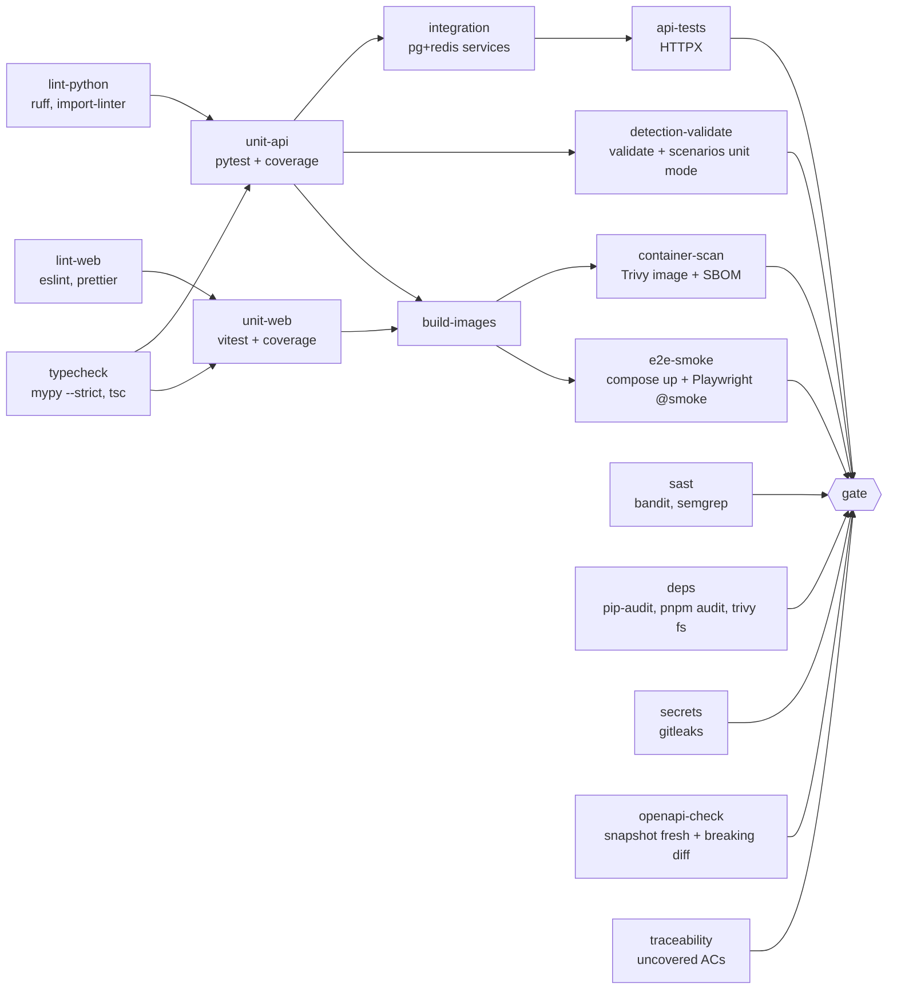

# AegisSOC — DevSecOps

| | |
|---|---|
| Owner | DevOps Agent; Security Reviewer Agent for gate policy |
| CI | GitHub Actions |

## 1. Branching, PRs, reviews, releases

- **Trunk-based:** `main` is always releasable. Short-lived branches `feat|fix|docs|chore|sec/<task-id>-<slug>`, ≤ 3 days.
- **Branch protection on `main`:** PR required, all blocking checks green, linear history (squash merge), no force pushes, signed commits recommended, administrators included.
- **PR requirements:** template completed (task ID, AC/SR IDs, implementation report, test evidence, QA note, security note where required, screenshots for UI); size guideline ≤ 400 changed lines excluding generated files.
- **Code review:** solo-maintainer project, so review = (1) Security Reviewer Agent pass, (2) QA Engineer Agent validation, (3) human approval. Agents comment; only the human approves and merges.
- **Commits:** Conventional Commits; reference IDs.
- **Versioning:** SemVer `0.MINOR.PATCH` during MVP; each sprint end may produce `v0.N.0`. MVP release target `v0.5.0` at end of Sprint 5. Tags annotated; CHANGELOG generated from commits (git-cliff).
- **Dependency updates:** Dependabot weekly for `uv`, `npm` (pnpm), `docker`, `github-actions`; grouped minor/patch PRs.

## 2. Pipeline

Workflows (created in Sprint 1, S1-T13):

| Workflow | Trigger | Jobs |
|---|---|---|
| `ci.yml` | pull_request, push to main | see table below |
| `nightly.yml` | schedule 03:00 UTC | full E2E, perf smoke, ZAP baseline (from S5), Trivy re-scan of images with latest DB |
| `release.yml` | tag `v*` | build + scan + SBOM + push images to GHCR (optional), GitHub release with QA report |

`ci.yml` job graph:

| # | Stage | Tool | Blocking |
|---|---|---|---|
| 1 | Linting | ruff, eslint, prettier, import-linter, hadolint (Dockerfiles), actionlint | Yes |
| 2 | Type checking | mypy --strict, tsc --noEmit | Yes |
| 3 | Unit tests | pytest, vitest (+ coverage thresholds) | Yes |
| 4 | Integration tests | pytest with Postgres/Redis service containers | Yes |
| 5 | API tests | pytest + HTTPX against app + services | Yes |
| 6 | E2E | Playwright `@smoke` on Compose stack (full on main/nightly) | Yes (smoke) |
| 7 | Detection validation | `aegissoc detections validate` + `test` | Yes |
| 8 | SAST | Bandit (High = fail), Semgrep (`p/python`, `p/typescript`, `p/react`, `p/owasp-top-ten`, `p/secrets` + custom rules in `.semgrep/`) | Yes on ERROR severity |
| 9 | Dependency scanning | pip-audit, pnpm audit `--audit-level high`, Trivy fs | Yes on High/Critical with fix available |
| 10 | Secret scanning | Gitleaks (full history on main, diff on PR) | Yes |
| 11 | Container scanning | Trivy image (OS + libs), config (Dockerfile/compose misconfig) | Yes on High/Critical with fix available |
| 12 | Build validation | docker buildx build for backend, edge(web), generator; `vite build` | Yes |
| — | OpenAPI check | regenerate & diff (S1); `oasdiff breaking` vs the `v0.1.0` snapshot (from S2); frontend generated API types fresh | Yes |
| — | Traceability | `make traceability --check` | Yes (from S2) |
| — | SBOM | Trivy CycloneDX, uploaded as artefact | No (artefact) |

Custom Semgrep rules (`.semgrep/aegissoc.yml`): forbid `pickle`, `yaml.load` without SafeLoader, `subprocess` with `shell=True`, raw SQL `text()` with f-strings, `dangerouslySetInnerHTML`, `eval`, `requests`/`httpx` calls outside the allowlisted client modules, logging of variables named `*password*|*secret*|*token*`.

## 3. Quality gates

**Mandatory to merge:** all blocking stages above green. **A failed critical security check (secret detected, High/Critical SAST/dependency/container finding with available fix, failed RBAC/auth security test) blocks merge and release.**

Waivers: only for findings with no fix available or confirmed false positives; recorded in `docs/security/waivers.md` (ID, finding, justification, owner, expiry ≤ 30 days) and in tool config (`.trivyignore`, `# nosemgrep: <rule> -- WAIVER-n`). Waivers are reviewed by the Security Reviewer Agent and approved by the human.

**Release gate (`release.yml`):** everything above + full E2E + detection regression + security checklist confirmation file `docs/security/release-checklist-vX.Y.Z.md`.

## 4. CI hardening (SR-40)

- `permissions: contents: read` at workflow level; jobs elevate only as needed (`packages: write` in release only).
- Third-party actions pinned by full commit SHA with version comment; Dependabot updates them.
- No `pull_request_target`. Secrets not available to fork PRs. No self-hosted runners.
- Caches keyed by lockfile hashes; no untrusted cache restore in release.
- `concurrency` to cancel superseded runs.

## 5. Local developer tooling

- `pre-commit`: ruff, ruff-format, gitleaks protect, end-of-file, check-yaml, prettier.
- `Makefile` targets (S1-T01): `setup`, `setup-ci`, `bootstrap-admin`, `up`, `down`, `logs`, `psql`, `trust-ca`, `seed`, `test-unit`, `test-integration`, `test-api`, `test-e2e`, `test-detections`, `lint`, `typecheck`, `scan`, `openapi`, `docs-check`, `traceability`, `demo-data`, `backup`, `restore`, `reset`, `upgrade`. Targets whose feature arrives in a later sprint print "available from Sprint N" and exit 0. `psql-ro` is added only if the Postgres MCP server is approved (D-07).
