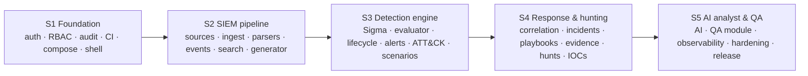

# AegisSOC — Development Roadmap

| | |
|---|---|
| Duration | 10 weeks · 5 sprints × 2 weeks |
| Capacity | ~10–15 human hours/week → **~20–30 h per sprint** of human time (reviewing, approving, testing, steering). Implementation is done by Claude Sonnet; human time is the bottleneck. |
| Current sprint | **Sprint 1 — implementation authorised 2026-11-21 (D-08 scope, D-10 go-ahead; Sonnet implements).** S1-T13 cannot complete until D-05. Sprints 2–5 not approved. |
| MVP release | `v0.5.0` at end of Sprint 5 |

## 1. Strategy

- **Vertical slices with a working demo every sprint.** Each sprint ends with something a reviewer can run.
- **Foundations first:** auth, audit, CI and hardening in Sprint 1 so every later feature inherits them.
- **Data before detections before workflow before AI.** AI needs alerts/incidents to be useful; detections need normalised data.
- **Every sprint has a stretch list.** If capacity runs short, stretch items move to the post-MVP backlog; committed items do not slip silently.
- **Agents and skills just in time.** Each sprint's first task creates only the agents/skills that sprint needs (schedule: AGENT_SPECIFICATION status line, SKILLS_SPECIFICATION §3).

Effort scale for human time per task: **S** ≤ 1 h · **M** 1–3 h · **L** 3–6 h.

---

## Sprint 1 (weeks 1–2) — Foundation

**Objective:** a secure, tested, CI-gated skeleton: users can log in to an empty but hardened platform; every later feature inherits auth, RBAC, audit, errors, CI and container hardening.
**Full specification:** [sprints/SPRINT_01.md](sprints/SPRINT_01.md).

| Task | Summary | Agent | Depends on | Effort |
|---|---|---|---|---|
| S1-T01 | Repo tooling: Makefile (`setup`, `setup-ci`, `bootstrap-admin`, …), prerequisite check, secret generation, pre-commit, editorconfig, `.env.example`, CHANGELOG | DevOps | — | S |
| S1-T02 | Backend project skeleton (`uv`, package layout, import-linter contracts) | Orchestrator | T01 | M |
| S1-T03 | Core: settings, logging, request ID, problem+json, pagination util, clock | Orchestrator | T02 | M |
| S1-T04 | DB: async engine, Alembic, roles, migration `users` + `audit_log` (+ immutability trigger) | Orchestrator | T03 | M |
| S1-T05 | Health endpoints | Orchestrator | T04 | S |
| S1-T06 | Auth: argon2id, sessions in Redis, login/logout/me/password, CSRF, progressive login throttling (D-09) | Orchestrator | T04 | L |
| S1-T07 | RBAC: permission registry, route declaration enforcement, user admin endpoints | Orchestrator | T06 | M |
| S1-T08 | Audit service + `GET /audit-log` | Orchestrator | T04, T07 | S |
| S1-T09 | Security middleware: size limits, trusted proxy, API headers (generic rate limiter → S2-T02) | Orchestrator | T03 | S |
| S1-T10 | Bootstrap admin CLI + OpenAPI export + snapshot | Orchestrator | T07 | S |
| S1-T11 | Web: Vite/React/TS/Tailwind/shadcn, tokens, router, API client, login, shell, users page (audit-log UI → S2-T10) | Orchestrator | T10 | L |
| S1-T12 | Infra: Dockerfiles, compose core, Caddy, secrets setup, hardening, migrate job — its Postgres/Redis part runs first as **S1-T12a** (after T03, before T04) so integration tests have a disposable DB | DevOps | T05, T09, T11 (T12a: T03) | L |
| S1-T13 | CI: `ci.yml` with all stages, Dependabot, Semgrep custom rules | DevOps | T12 | M |
| S1-T14 | QA: fixtures, API/security tests, Playwright login E2E, Sprint 1 QA report | QA Engineer | T06–T13 | M |
| S1-T15 | 4 agent files (QA Engineer, Security Reviewer, DevOps, Documentation), 2 skills (`python-backend`, `react-frontend`), `.claude/settings.json` guardrails (MCP only if approved) | Orchestrator | approval | S |
| S1-T16 | README quick start verified on a clean clone, threat-model delta, sprint security review (other doc updates happen inside each task per the DoD) | Documentation + Security Reviewer | all | S |

**Deliverables:** running `core` stack; login/logout; admin user management; audit log API (UI in S2); green CI with all gates; Sprint 1 QA report.
**Tests:** TC-PLAT-01…13, TC-SEC-01…06, 08, 12, 18…24 (S1 parts), TC-INF-01…05, TC-E2E-01…02.
**Acceptance criteria:** AC-PLAT-01…16, AC-QA-05, AC-QA-07.
**Stretch:** password change UI; `make trust-ca`.
**Estimated human time:** ≈ 29.5 h after audit reductions R1–R6 and corrections B-1…B-8 (capacity 20–30 h). **Cut line:** if > 25 h by day 10, the Users admin UI moves to S2 (API and tests stay in S1).

---

## Sprint 2 (weeks 3–4) — SIEM pipeline

> ⚠ **Requires re-planning before it starts (pending M-5).** As listed, Sprint 2 is ≈ 36.5 h of tasks + ≈ 1.5 h of just-in-time agents/skills ≈ **38 h** against 20–30 h, partly because it received the generic rate limiter and the audit-log UI from Sprint 1. The table below is the *unbalanced* task list; `SPRINT_02.md` must re-scope it (and resolve M-1, M-3, m-7, m-12) before Sprint 2 is approved.

**Objective:** synthetic telemetry flows from the generator through ingestion and normalisation into a searchable event store, observable per source.

| Task | Summary | Agent | Depends on | Effort |
|---|---|---|---|---|
| S2-T01 | Log sources, retention policies, API keys (models, API, admin UI) | Orchestrator | S1 | M |
| S2-T02 | Ingest endpoint: key auth, envelope validation, limits, `ingest_batches`, XADD, backpressure; **generic rate-limit framework** (per principal/route group, `RateLimit-*` headers — moved from S1) | Orchestrator | T01 | L |
| S2-T03 | Worker framework: consumer groups, XAUTOCLAIM, retries, DLQ, graceful shutdown, heartbeat, leader lock | Orchestrator | S1 | L |
| S2-T04 | Events table (partitioned), partition manager, ECS normalised model | Orchestrator | S1 | M |
| S2-T05 | Parsers ×6 with golden files + hypothesis tests | Orchestrator (+ SIEM skill) | T04 | L |
| S2-T06 | Normaliser consumer: parse → store → errors → publish normalized | Orchestrator | T03, T04, T05 | M |
| S2-T07 | Query DSL compiler + `/events/search`, detail, timeline, aggregate, fields, export | Orchestrator | T04 | L |
| S2-T08 | Ingestion health + retention jobs | Orchestrator | T03, T06 | M |
| S2-T09 | Synthetic generator service: baseline + 3 storylines (D03, D07, D08) + manifest | Threat Hunter + Orchestrator | T02 | M |
| S2-T10 | Events explorer UI + sources admin UI + ingest errors view + audit-log viewer (moved from S1) | Orchestrator | T07 | L |
| S2-T11 | Basic `/metrics` (ingest, pipeline, HTTP) | DevOps | T06 | S |
| S2-T12 | Traceability script `make traceability` | QA Engineer | S1 | S |
| S2-T13 | QA: TC-SIEM-*, TC-SEC-07/09/10/11/15/22/25, TC-PERF-01/03, QA report | QA Engineer | all | M |

**Deliverables:** `make demo-data` produces searchable events from 6 source types; explorer UI; health view.
**Acceptance criteria:** AC-SIEM-01…14, AC-OBS-01 (basic), AC-QA-08.
**Stretch:** AC-SIEM-15 Fluent Bit profile; remaining storylines.

---

## Sprint 3 (weeks 5–6) — Detection engine and alerts

**Objective:** Sigma rules are managed as versioned, validated, tested content and generate deduplicated alerts in near-real time.

| Task | Summary | Agent | Depends on | Effort |
|---|---|---|---|---|
| S3-T01 | Rules + versions model/API, content hashing, history/diff | Orchestrator | S2 | M |
| S3-T02 | pySigma integration, AegisSOC processing pipeline (field mapping), static validator | Orchestrator | T01 | L |
| S3-T03 | Evaluator (predicate compiler, RE2, budget) + conformance suite | Orchestrator | T02 | L |
| S3-T04 | ATT&CK import + coverage endpoint | Orchestrator | S1 | S |
| S3-T05 | Detector consumer + alert service (dedup, severity) + alert API | Orchestrator | T03 | M |
| S3-T06 | Scenario format, runner (unit + pipeline), validation runs API, `detections` CLI | Orchestrator | T03 | M |
| S3-T07 | Lifecycle + four-eyes + activation precondition + audit; `make seed` demo users with random passwords (SR-16) | Orchestrator | T06 | M |
| S3-T08 | Detection content: D03, D05–D08, D10–D12 + scenarios + storylines | Detection Engineer + Threat Hunter | T06 | M |
| S3-T09 | CI detection gate (validate + test) | DevOps | T06 | S |
| S3-T10 | Rules UI (list, editor, findings, versions, test panel, lifecycle) + Alerts queue UI + basic Overview | Orchestrator | T05, T07 | L |
| S3-T11 | QA: TC-DET-01…08, 10…12, TC-INC-01, TC-SEC-13/14/27, TC-PERF-04, E2E-04/05, QA report | QA Engineer | all | M |

**Deliverables:** 8 active rules with scenarios; alerts appear from generator storylines; rule lifecycle demo with two users.
**Acceptance criteria:** AC-DET-01…08, 10 (basic), 11, 12 (S3 set), 13; AC-INC-01; AC-QA-01…03; AC-OBS-04 (basic).
**Stretch:** ATT&CK coverage matrix UI.

---

## Sprint 4 (weeks 7–8) — Correlation, incidents, hunting, intel

**Objective:** analysts can work alerts into incidents end to end with playbooks and evidence, hunt across events and use IOC lists; correlation completes the rule set.

| Task | Summary | Agent | Depends on | Effort |
|---|---|---|---|---|
| S4-T01 | Correlation engine (event_count, value_count, temporal) + D01, D02, D04, D09 | Orchestrator + Detection Engineer | S3 | L |
| S4-T02 | Alert disposition, bulk triage, FP metrics rollup | Orchestrator | S3 | M |
| S4-T03 | Incidents: model, state machine, assignment, linking, metrics | Orchestrator | T02 | M |
| S4-T04 | Notes, timeline, evidence (files + references) | Orchestrator | T03 | L |
| S4-T05 | Playbooks (5 YAML) + checklist + suggestions; incident report | Blue Team + Orchestrator | T03 | M |
| S4-T06 | Hunts, runs, retro-hunt, related activity, hunt report | Orchestrator | S2 DSL, S3 evaluator | M |
| S4-T07 | IOC lists, CSV/STIX import, matcher consumer, IOC alerts | Orchestrator + Threat Hunter | S3 alerts | M |
| S4-T08 | UI: incident list + investigation workspace, hunting workspace, IOC pages | Orchestrator | T03–T07 | L |
| S4-T09 | QA: TC-INC-*, TC-HUNT-01…07, 09, TC-DET-09, TC-SEC-16, E2E-06/07/08, QA report | QA Engineer | all | M |

**Deliverables:** full alert → incident → close workflow; 12 active rules; hunting with saved hunts; IOC matching.
**Acceptance criteria:** AC-DET-09, AC-DET-10 (dispositions), AC-DET-12 (S4 set); AC-INC-02…13; AC-HUNT-01…07.
**Stretch:** `temporal_ordered` correlation; ATT&CK matrix UI if not done.

---

## Sprint 5 (weeks 9–10) — AI analyst, QA module, observability, release

**Objective:** a human-in-the-loop AI analyst with verified, cited output; visible QA evidence; dashboards; release `v0.5.0`.

| Task | Summary | Agent | Depends on | Effort |
|---|---|---|---|---|
| S5-T01 | AI module: provider interface, FixtureProvider, context builder, redaction, job runner | Orchestrator | S4 | L |
| S5-T02 | AnthropicProvider (Messages API, structured output, read-only tools, refusal/budget handling) | Orchestrator (consult `claude-api` skill) | T01 | M |
| S5-T03 | Output validator (schema, citations), proposed actions apply/dismiss | Orchestrator | T01 | M |
| S5-T04 | AI tasks ×7 prompts + fixtures; prompt-injection & redaction corpora | Orchestrator + Blue Team (`soc-analysis`) | T03 | M |
| S5-T05 | AI UI panel + history | Orchestrator | T03 | M |
| S5-T06 | QA module UI: validation screen, quality indicators, reports; ground-truth evaluation | Orchestrator + QA Engineer | S3 | M |
| S5-T07 | Observability profile: full metrics, Grafana dashboards, alert rules + promtool tests | DevOps | S2 metrics | M |
| S5-T08 | Hardening: ZAP baseline (local), perf re-run, backup/restore drill, system admin page | DevOps + Security Reviewer | all | M |
| S5-T09 | Release: docs, demo script, CHANGELOG, release checklist, `v0.5.0` | Documentation + human | all | S |
| S5-T10 | QA: TC-AI-*, TC-QA-*, TC-OBS-*, TC-SEC-17/26, TC-INF-06, E2E-09…12, final QA report | QA Engineer | all | M |

**Deliverables:** AI panel working with fixture provider offline and optionally with Anthropic; QA dashboard; Grafana; release.
**Acceptance criteria:** AC-AI-01…15, AC-QA-02 (UI), 04, 06, AC-OBS-01…04.
**Stretch:** mutation testing on evaluator; light theme.

---

## 2. Cross-sprint risks to capacity

| Risk | Signal | Response |
|---|---|---|
| Sprint 1 overruns (auth + CI + infra is front-loaded) | > 25 h by day 10 | Move the Users admin UI to S2 (API and tests stay; audit UI is already in S2); never cut security tests |
| Evaluator complexity (S3) | conformance suite < 80 % by mid-sprint | Drop `windash`, `cidr` to S4; keep core modifiers |
| AI provider behaviour (S5) | refusals on security content | Fixture provider keeps demo working; document live-provider results honestly |

## 3. Post-MVP backlog (ordered)

1. MFA (TOTP) for users
2. MISP pull connector (AC-HUNT-08)
3. OpenSearch backend behind `EventSearchBackend`
4. `temporal_ordered` correlation, asset criticality in severity
5. Fluent Bit profile (if not done in S2)
6. OpenTelemetry tracing
7. Sigma rule import from SigmaHQ with DRL attribution and automated field-mapping report
8. Markdown rendering of notes with a sanitiser (DOMPurify) + CSP review
9. Multi-tenant / per-team visibility
10. Notification channels for platform alerts
