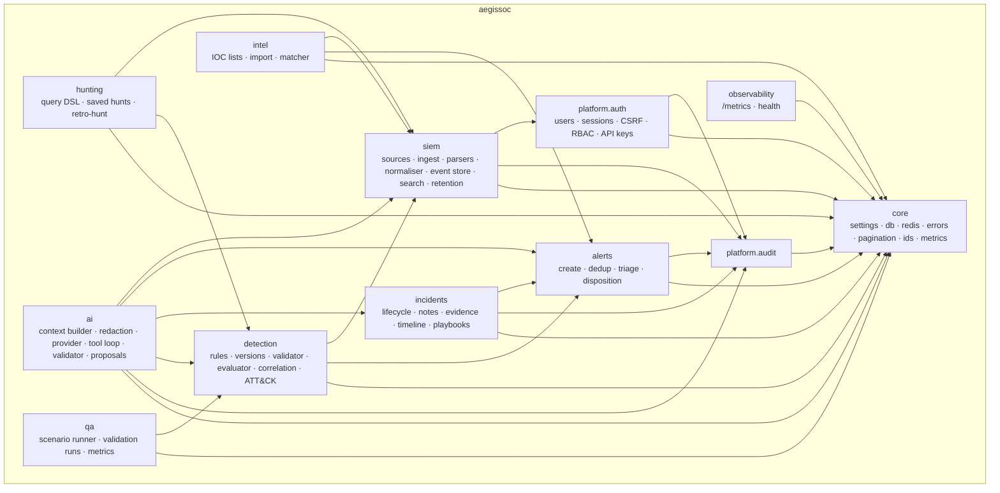

# Component diagram — backend modules

Arrows mean "calls the service interface of". Modules never import another module's models or touch its tables (enforced by import-linter).



Each module has the same internal layout:

```
aegissoc/<module>/
  api.py        # FastAPI router (HTTP only: parse, authorise, call service)
  service.py    # public interface for other modules + business logic
  models.py     # SQLAlchemy models (private to module)
  schemas.py    # Pydantic request/response models
  repository.py # queries (private)
  workers.py    # stream consumers (if any)
```
