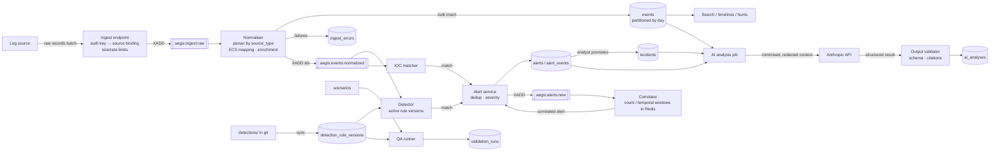

# Data flow

Data classification used for minimisation (see [SECURITY.md §6](../../SECURITY.md#6-data-protection)):

| Class | Examples | Leaves host? |
|---|---|---|
| C1 Secrets | passwords, session IDs, API keys, Anthropic key | Never |
| C2 Identifiers | usernames, emails, internal IPs, hostnames | Only to Anthropic, only when AI enabled, optionally pseudonymised |
| C3 Event content | command lines, URLs, messages | Only to Anthropic, minimised, wrapped as untrusted data |
| C4 Metadata | rule IDs, ATT&CK IDs, counts | Yes (to Anthropic when AI enabled) |
