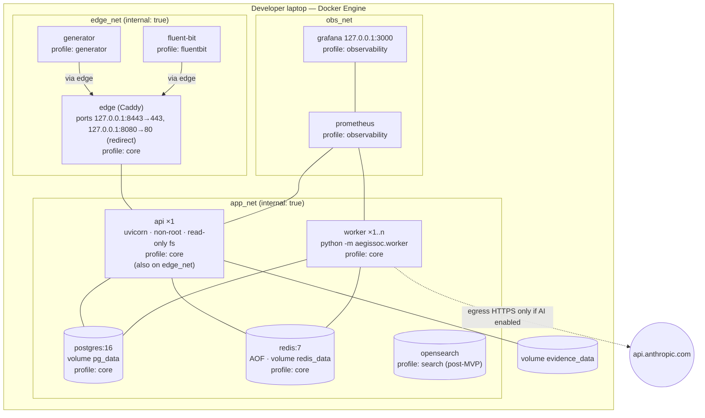

# Deployment diagram (Docker Compose, single host)

| Container | Memory limit | Notes |
|---|---|---|
| edge | 64 MB | |
| api | 512 MB | |
| worker | 512 MB | |
| postgres | 1 GB | `shared_buffers=256MB` |
| redis | 256 MB | `maxmemory-policy noeviction` (streams must not be evicted) |
| **core total** | **≈ 2.3 GB** | fits the ≤ 2.5 GB budget |
| generator | 128 MB | |
| fluent-bit | 64 MB | |
| prometheus + grafana | 512 MB | |
| opensearch | 2–4 GB | post-MVP only |

The edge additionally joins `public_net` (plain bridge) so its ports can be published; no other service joins it.

Egress: `edge_net` and `app_net` are `internal: true`. The worker joins an additional `egress_net` **only** when `AEGIS_AI_ENABLED=true`, so no other container can reach the internet.
