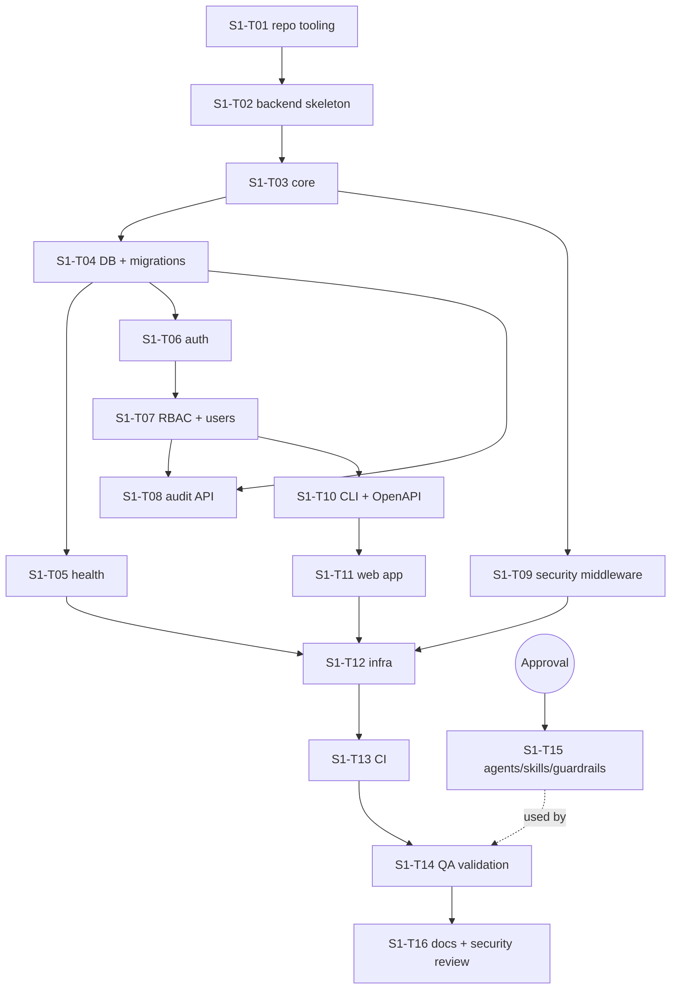

# Sprint 1 — Foundation (weeks 1–2)

| | |
|---|---|
| Status | **Authorised (D-08 scope + D-10 go-ahead, 2026-11-21) — implementation by Claude Sonnet under [SPRINT_01_EXECUTION_PROTOCOL.md](../SPRINT_01_EXECUTION_PROTOCOL.md) rev. 2.** S1-T13 cannot be completed until **D-05** (GitHub repository). |
| Objective | A secure, tested, CI-gated skeleton. A user can log in to an empty but hardened platform. Every later feature inherits auth, RBAC, audit, error model, CI gates and container hardening. |
| Capacity | ~20–30 human hours available · **estimated ≈ 29.5 h** after audit reductions R1–R6 and corrections B-1…B-8 ([PLANNING_AUDIT_REPORT §12](../PLANNING_AUDIT_REPORT.md#12-revision-2--corrections-applied)) |
| Acceptance criteria | AC-PLAT-01 … AC-PLAT-16, AC-QA-05, AC-QA-07 |
| Security requirements in scope | SR-01…SR-07, SR-09, SR-13, SR-16…SR-20, SR-21 (login throttling only — generic rate limiter moved to S2, audit R3), SR-22 (generic), SR-23…SR-27, SR-39, SR-40, SR-41 |
| Out of scope | Anything from Sprint 2+: log sources, ingestion, worker process, events, rules, alerts, incidents, AI, Grafana; also the generic API rate limiter and the audit-log **UI** (both moved to S2 by audit R3/R4). Do **not** add nav items or placeholder pages for them. |

---

## 1. Fixed technical decisions for this sprint

| Item | Decision |
|---|---|
| Python | 3.12, managed by `uv`; lockfile committed |
| Backend deps (runtime) | `fastapi`, `uvicorn[standard]`, `pydantic`, `pydantic-settings`, `sqlalchemy[asyncio]`, `asyncpg`, `alembic`, `redis`, `argon2-cffi`, `structlog`, `uuid6` (UUIDv7 on 3.12) — pin latest stable at implementation time |
| Backend deps (dev) | `pytest`, `pytest-asyncio`, `pytest-cov`, `httpx`, `ruff`, `mypy`, `import-linter`, `bandit`, `pip-audit` (`hypothesis` arrives in S2 with the parsers — audit R5) |
| CLI | stdlib `argparse` (no Typer/Click) — entrypoint `aegissoc` |
| Node | 22 LTS, `pnpm` workspaces: `apps/web`, `qa/e2e` |
| Frontend deps | `react`, `react-dom`, `react-router`, `@tanstack/react-query`, `openapi-fetch`, shadcn/ui generated components (+ their Radix deps, `class-variance-authority`, `clsx`, `tailwind-merge`, `lucide-react`), `@fontsource/inter`, `@fontsource/jetbrains-mono`; dev: `vite`, `typescript`, `tailwindcss` v4 + `@tailwindcss/vite`, `eslint`, `prettier`, `vitest`, `@testing-library/react`, `jsdom`, `openapi-typescript` |
| E2E deps | `@playwright/test`, `@axe-core/playwright` |
| Images | `python:3.12-slim` (digest-pinned) for backend; `caddy:2` for edge (web assets copied in a multi-stage build from `node:22-slim`); `postgres:16`; `redis:7.4` (decision D-02: Valkey 8 is a drop-in alternative) |
| Ports | edge `127.0.0.1:8443` (HTTPS), `127.0.0.1:8080` (redirect) |
| Host prerequisites | [DEPLOYMENT.md §0](../DEPLOYMENT.md#0-developer-prerequisites) — checked by `scripts/check-prereqs`, run first by `make setup` |
| Login throttling | Decision **D-09** ([DECISIONS.md](../DECISIONS.md)): progressive per-username delay, per-IP limit, no hard lockout |

Any additional runtime dependency needs a justification in the PR (CLAUDE.md rule).

## 2. Implementation sequence and dependencies



Recommended order: **T15 → T01 → T02 → T03 → T12a → T04 → T05 → T09 → T06 → T07 → T08 → T10 → T11 → T12 → T13 → T14 → T16.** T15 goes first and is reviewed by the human (HC-1) before any subagent works. **T12a** is the Postgres/Redis part of T12 (data services + disposable test overlay), pulled forward so T04–T10 can run integration tests; it is not new scope. Authoritative dependency table: [SPRINT_01_EXECUTION_PROTOCOL.md §3.1](../SPRINT_01_EXECUTION_PROTOCOL.md#31-machine-checkable-dependency-table).

PR grouping (≤ 400 lines each where possible; revised 2026-11-21 to remove two ordering violations): PR1 T15 · PR2 T01+T02 · PR3 T03 · PR4 T12a · PR5 T04+T05 · PR6 T09 · PR7 T06 · PR8 T07+T08+T10 · PR9 T11 · PR10 T12 · PR11 T13 · PR12 T14+T16.

---

## 3. Tasks

### S1-T15 — Agents, skills and guardrails (do first)
- **Create only the four agents Sprint 1 uses** (audit R1): `.claude/agents/{qa-engineer,security-reviewer,devops,documentation}.md` from AGENT_SPECIFICATION §3 (frontmatter `name`, `description`, `tools`, `model`; body = mission, responsibilities, boundaries, escalation, output format). Architect, Threat Hunter, Detection Engineer and Blue Team are created just in time (AGENT_SPECIFICATION status line).
- **Create only two skills:** `.claude/skills/python-backend/SKILL.md` and `.claude/skills/react-frontend/SKILL.md` (SKILLS_SPECIFICATION §2.9, §2.10). Other skills follow the schedule in SKILLS_SPECIFICATION §3.
- **Create:** `.claude/settings.json` with the deny/ask rules of AGENT_SPECIFICATION §2.
- **MCP:** do **not** create `.mcp.json` unless the human approved specific servers (decision D-07).
- **Done when:** files exist, match the specs, `git diff` reviewed by human. (TC-INF-05)

### S1-T01 — Repository tooling
- **Create:** `Makefile` with targets from DEVSECOPS §5 (targets for later sprints may print "available from Sprint N" and exit 0); `.pre-commit-config.yaml` (ruff, ruff-format, gitleaks, check-yaml, end-of-file-fixer, prettier); `.editorconfig`; `.env.example` (non-secret settings only); `CHANGELOG.md` (Keep a Changelog); `pnpm-workspace.yaml`; root `package.json` (workspace scripts only).
- **`make setup`** (host only, no containers): runs `scripts/check-prereqs` (POSIX `sh`; checks the tools and minimum versions in DEPLOYMENT §0, prints what is missing, exits non-zero), installs pre-commit hooks, and generates `infrastructure/compose/secrets/{postgres_superuser_password,postgres_owner_password,postgres_app_password,redis_password}` (32 random bytes, base64url; files mode 600, directory mode 700; existing files are never overwritten). It creates **no** users.
- **`make setup-ci`**: the same, plus a random `bootstrap_admin_password` used only by CI.
- **`make bootstrap-admin`** (after `make up`): `docker compose exec -it api aegissoc admin create --username admin`, prompting for the password (stdin, no echo).
- **Done when:** the three targets behave as above, a second `make setup` changes nothing, and `pre-commit run --all-files` passes.

### S1-T02 — Backend skeleton
- **Layout:**
```
apps/api/
  pyproject.toml            # project, deps, ruff, mypy (strict for aegissoc), pytest, coverage config
  alembic.ini
  .importlinter             # contracts below
  src/aegissoc/
    __init__.py
    main.py                 # create_app() factory
    cli.py                  # argparse entrypoint `aegissoc`
    core/ {config,logging,db,redis,errors,pagination,ids,clock,security_headers,ratelimit}.py
    platform/auth/ {api,service,models,schemas,repository,passwords,sessions,csrf,rbac,throttle}.py
    platform/audit/ {api,service,models,schemas}.py
    observability/ health.py
    migrations/ env.py, versions/
  tests/unit/ …
  tests/fixtures/common_passwords.txt   # 10k list, licence noted in header (e.g. SecLists, MIT)
```
- **import-linter contracts:** (1) `aegissoc.core` imports no other `aegissoc` package; (2) independence between module packages except via `service` modules (layers contract: `api` → `service` → `repository/models`); (3) no module imports another module's `models` or `repository`.
- **Done when:** `uv run pytest` (empty suite placeholder passes), `ruff check`, `mypy`, `lint-imports` all pass.

### S1-T03 — Core
- `config.py`: `Settings(BaseSettings)` with prefix `AEGIS_`, `*_FILE` secret loading helper, validation (fails fast on missing secrets outside `ci`).
- `logging.py`: structlog JSON; processor that drops keys matching `password|secret|token|session|authorization|cookie` (case-insensitive) — SR-18.
- `errors.py`: `ProblemDetail` model; exception handlers for `HTTPException`, `RequestValidationError`, domain errors (`NotFound`, `Conflict`, `InvalidTransition`, `VersionMismatch`, `Forbidden`) and catch-all 500 without traceback — AC-PLAT-10.
- Request ID middleware: accept `X-Request-ID` if it matches `^[A-Za-z0-9-]{8,64}$`, else generate UUIDv7; bind to log context; echo header.
- `pagination.py` (audit B-2/R2 — **no HMAC, no secret**): opaque cursor = base64url(JSON `{"v":1,"k":<last sort key>,"id":<uuid>}`). Strict validation: ≤ 512 chars, valid base64url, valid JSON object with exactly these keys, `v == 1`, `id` a UUID, `k` of the type of the active sort field; anything else → 400 `bad-request`. Cursor values are only ever bound SQL parameters evaluated under the caller's own permissions, so a forged cursor gains nothing. `Page[T]` generic response model.
- `ids.py` (UUIDv7), `clock.py` (`Clock` protocol, `SystemClock`, `FrozenClock` for tests).
- **Tests:** unit tests for cursor round-trip and rejection of malformed/oversized/wrong-type cursors, request-ID validation, log redaction processor, problem handlers.

### S1-T04 — Database and migrations
- `db.py`: async engine (pool size 10), `AsyncSession` dependency (one transaction per request; commit on success).
- Postgres init script `infrastructure/compose/postgres/init/01-roles.sh` (written by DevOps in S1-T12a; specified here; runs once as the `postgres` superuser, password from `postgres_superuser_password`): creates `aegis_owner` and `aegis_app` (LOGIN, passwords from secret files), database `aegissoc` owned by `aegis_owner`, `ALTER SCHEMA public OWNER TO aegis_owner`, `REVOKE CREATE ON SCHEMA public FROM PUBLIC`. api/worker receive only the `aegis_app` password; only the `migrate` job receives `aegis_owner`'s.
- Migration `0001_platform`: `users` and `audit_log` exactly as DATABASE_DESIGN §2.1 (`citext` is a trusted extension, so the database owner can create it); triggers `audit_log_immutable` and `audit_log_no_truncate`; function `aegis_purge_audit_before` (DATABASE_DESIGN §6); grants exactly as DATABASE_DESIGN §6 (`aegis_app`: SELECT/INSERT/UPDATE on `users`; **SELECT/INSERT only** on `audit_log`; EXECUTE on the purge function).
- **Tests:** TC-SEC-19 (UPDATE/DELETE/TRUNCATE on `audit_log` as `aegis_app` fail; the purge function refuses a cutoff inside the 90-day floor and, when allowed, deletes only older rows and writes a summary row), migration up → down → up on empty DB.

### S1-T05 — Health
- `/api/v1/health/live` and `/api/v1/health/ready` (checks `SELECT 1` and Redis `PING`, each with 1 s timeout). Body shows only `ok|fail` per check name.
- **Tests:** TC-PLAT-07 (integration, stopping containers in CI via docker compose).

### S1-T06 — Authentication
- `passwords.py`: argon2id `PasswordHasher(time_cost=3, memory_cost=65536, parallelism=4)`; `check_needs_rehash` on login; policy: length 12–128, not in common list (case-insensitive), not equal to username.
- `sessions.py`: create (32 random bytes → base64url id; store `sess:<sha256>` hash with user_id, role, csrf_token (32 bytes), created_at, last_seen, ip; TTL = idle timeout, never past absolute), touch, revoke, revoke_all_for_user (via set `user_sess:<user_id>`).
- `csrf.py`: dependency that, for unsafe methods with cookie auth, compares `X-CSRF-Token` to session token with `hmac.compare_digest` → 403 `csrf-failed`.
- `throttle.py` (decision **D-09**): per-IP fixed window `rl:login:ip:<ip>` 20/60 s → 429. Per-username state `auth:fail:<sha256(lower(username))>` = `{n, last_failure}` in Redis (TTL 24 h), kept for unknown usernames too (no enumeration). When `n ≥ 5` and `now < last_failure + min(30 s · 2^(n−5), 900 s)` → 429 with `Retry-After`, **without** verifying the password or incrementing `n`; otherwise verify: success deletes the state, failure increments `n` and updates `users.last_failed_login_at` for existing users. At `n` = 10, 20, 30 … write audit `auth.login.repeated_failures`. **No hard lockout.** `reset_throttle(username)` backs the admin endpoint.
- Timing: unknown username verifies against a precomputed dummy hash.
- Routes: `POST /auth/login`, `POST /auth/logout`, `GET /auth/me`, `POST /auth/password` (API_SPECIFICATION §2.2).
- Cookie: `__Host-aegis_session`, `Secure; HttpOnly; SameSite=Strict; Path=/`; no `Max-Age` (session cookie) — server enforces expiry.
- Audit: `auth.login.success|failure|throttled|repeated_failures`, `auth.logout`, `auth.password.change`.
- **Tests:** TC-PLAT-01…04, TC-SEC-01…04, TC-SEC-08, TC-SEC-23 (log grep).

### S1-T07 — RBAC and user administration
- `rbac.py`: `Permission` enum with **all** permissions of SECURITY.md §3.2; `ROLE_PERMISSIONS` mapping exactly that table; `require(permission)` dependency returning the current user; marker attribute on the route so a test can enumerate.
- Enforcement test (TC-SEC-24): iterate `app.routes`; every `/api/v1/*` route except the anonymous allowlist (`/auth/login`, `/health/*`) must have exactly one permission marker or the `authenticated` marker.
- Users API (API_SPECIFICATION §2.2): list/create/get/patch/reset-login-throttle; self-demote/self-disable → 409; role change or deactivation → `revoke_all_for_user`; audit `user.create|update|role_change|deactivate|throttle_reset`.
- **Tests:** TC-PLAT-05, TC-SEC-05 (parametrised matrix from the single `ROLE_PERMISSIONS` source **and** an independent copy of the table in the test file, so a change to one without the other fails), TC-SEC-06 (S1 parts).

### S1-T08 — Audit
- `audit.service.record(...)` used by auth/users; `GET /audit-log` with filters and cursor pagination, permission `audit:read`.
- **Tests:** TC-PLAT-06.

### S1-T09 — Security middleware
- Body size limit middleware (1 MiB default; route overrides later) → 413 problem.
- Trusted proxy: only honour `X-Forwarded-For/Proto` when the peer IP is in `AEGIS_TRUSTED_PROXY_CIDRS` (SR-41).
- *(Moved to Sprint 2 — audit R3.)* The generic per-route-group rate limiter is built in S2-T02 together with the ingestion limits. Sprint 1 keeps login throttling (S1-T06), which covers the only unauthenticated write surface.
- API response headers set by app as defence in depth: `Cache-Control: no-store`, `X-Content-Type-Options: nosniff` (full set at edge).
- **Tests:** TC-SEC-21, TC-SEC-22 (generic).

### S1-T10 — CLI and OpenAPI
- `aegissoc admin create --username <u> [--display-name] [--password-file <f>]` (default: read password from stdin without echo) — refuses if an admin exists unless `--force-additional`; validates password policy. Used by `make bootstrap-admin` (interactive) and by CI with `--password-file secrets/bootstrap_admin_password`. (AC-PLAT-12, TC-PLAT-10)
- `aegissoc openapi export > docs/api/openapi.json` (sorted keys, stable). `make openapi` regenerates; TC-PLAT-11 checks freshness.

### S1-T11 — Web application
- `apps/web`: Vite + React + TS strict; Tailwind v4 with tokens from UI_UX_SPECIFICATION §6 as CSS variables; shadcn/ui init (dark theme); self-hosted fonts.
- `src/lib/api.ts`: `openapi-fetch` client typed from generated `src/lib/api-types.ts` (`pnpm gen:api` from `docs/api/openapi.json`); middleware adds `X-CSRF-Token` from the auth context on unsafe methods and handles 401 → redirect to `/login?next=…`.
- `src/app`: router, `QueryClientProvider`, `AuthProvider` (`GET /auth/me` on load).
- Screens: Login; App shell (sidebar items filtered by permissions — in S1 only *Overview* (a welcome card showing the signed-in user, role and platform readiness; no references to future modules) and *Admin → Users*; the audit-log UI moves to S2 — audit R4, its API and tests stay in S1); Users page (table, create dialog, edit role/active, login-throttle badge with reset action, and a notice panel listing recent `auth.login.repeated_failures` events from `GET /audit-log` — the D-09 admin notification); 403 page; 404 page.
- No `dangerouslySetInnerHTML`; ESLint rule `react/no-danger` = error.
- **Tests:** Vitest for api middleware (CSRF header, 401 redirect), auth provider, permission-filtered nav.

### S1-T12 — Infrastructure
- **S1-T12a (done first, after T03):** the `postgres` and `redis` services of `compose.yaml` (hardened, internal network), `infrastructure/compose/postgres/init/01-roles.sh` (moved here from T04), `compose.test.yaml` (tmpfs overlay, project `aegissoc-test`, throwaway passwords) and `make test-db-up` / `test-db-down`. The procedure is in SPRINT_01_EXECUTION_PROTOCOL §6. The rest of T12 below follows T11.
- `infrastructure/docker/backend.Dockerfile` (multi-stage, `uv sync --frozen --no-dev`, non-root UID 10001, no compilers in runtime stage, `HEALTHCHECK`).
- `infrastructure/docker/edge.Dockerfile` (stage 1 `node:22-slim` builds web; stage 2 `caddy:2` copies `dist` to `/srv/web` and `Caddyfile`).
- `infrastructure/caddy/Caddyfile`: `tls internal`; `redir` HTTP→HTTPS; `handle /api/*` → `reverse_proxy api:8000`; SPA fallback `try_files {path} /index.html`; `request_body max_size 1MB`; `header` block with SR-20 values and `-Server`.
- `infrastructure/compose/compose.yaml` (`core`): edge, api, migrate (one-shot), postgres, redis (requirepass from secret, AOF on, `maxmemory-policy noeviction`); networks `public_net`, `edge_net` (internal, fixed subnet so edge IP is known for SR-41), `app_net` (internal); secrets; hardening flags from DEPLOYMENT §5; memory limits from deployment diagram. (The `worker` service joins `core` in Sprint 2.)
- `scripts/check-compose` (Python, stdlib only): parses `docker compose config --format json` and asserts hardening rules (TC-INF-01).
- **Done when:** `make up` healthy in ≤ 3 min; `https://localhost:8443` serves login; `docker stats` within budget (TC-PLAT-12); TC-SEC-18, TC-INF-02 manual checks recorded.

### S1-T13 — CI
- `.github/workflows/ci.yml` implementing DEVSECOPS §2 stages applicable to S1 (traceability stage from S2; detection stage prints "no detections yet" and passes). Security stages are all **blocking in S1** (non-negotiable): Bandit, Semgrep (incl. `.semgrep/aegissoc.yml`), Gitleaks, pip-audit, `pnpm audit`, Trivy filesystem scan, Trivy image scan of the backend and edge images, Trivy config scan of Dockerfiles/compose, plus SBOM artefact.
- Integration/API jobs use service containers `postgres:16`, `redis:7.4`; the E2E job runs `make setup-ci`, `make up`, creates the CI admin with `aegissoc admin create --password-file`, then Playwright `@smoke`.
- OpenAPI stage in S1: snapshot freshness only. The `oasdiff` breaking-change check starts in S2 against the `v0.1.0` snapshot (audit R5).
- `.github/dependabot.yml`; `.semgrep/aegissoc.yml` custom rules (DEVSECOPS §2); `.gitleaks.toml` (default + allowlist for test fixtures only).
- All actions pinned by SHA; `permissions: contents: read`.
- **Done when:** a PR runs all jobs green; TC-PLAT-13 canary PR demonstrates blocking (then closed, not merged).

### S1-T14 — QA validation (QA Engineer Agent, independent)
- Fixtures: `qa/conftest.py` with app factory, DB transaction-rollback session, Redis DB 15 flush, user factories per role, logged-in client fixtures per role. For E2E, role users are created through the admin API by the CI admin (audit m-8).
- TC-PLAT-02 is deterministic: it asserts the unknown-user path performs a dummy argon2 verification; timing is measured and reported, never asserted (audit R6).
- API tests in `qa/api/` and security tests in `qa/security/` for all S1 TCs; markers `@pytest.mark.req("AC-…")`/`("SR-…")`.
- Playwright project `qa/e2e/` with `@smoke` login/logout (TC-E2E-01), role nav (TC-E2E-02), axe check on login & users page.
- Coverage thresholds configured (QA_STRATEGY §6) → AC-QA-07.
- Report `qa/reports/sprint-01/QA_REPORT.md` from template with evidence (AC-QA-05).

### S1-T16 — Documentation and security review
- Scope kept small (≈ 0.5 h): documentation for each change is updated **inside its own task** (Task DoD). T16 only verifies the README quick start on a clean clone, records the threat-model delta and files the sprint security review.
- README quick start (verified by QA on a clean clone), DEPLOYMENT updated with any deviations, ADR statuses (human sets Accepted), CHANGELOG `0.1.0`.
- Security Reviewer: review of all S1 PRs → `docs/security/reviews/sprint-01.md`; threat model delta.

---

## 4. Sprint 1 acceptance checklist

| AC | Verified by | Pass condition |
|---|---|---|
| AC-PLAT-01 | TC-PLAT-01, TC-PLAT-02 | cookie attributes exact; identical failure responses |
| AC-PLAT-02 | TC-PLAT-03 | old cookie → 401 |
| AC-PLAT-03 | TC-PLAT-04 | idle/absolute expiry with frozen clock; rotation |
| AC-PLAT-04 | TC-SEC-08 | missing/wrong token → 403 |
| AC-PLAT-05 | TC-SEC-01 | after 5 failures: 429 + `Retry-After` 30→60→…→900 s cap; per-IP 21st/min → 429; same for unknown users; no lockout; notice audited at 10; admin reset audited |
| AC-PLAT-06 | TC-SEC-05, TC-SEC-24, TC-E2E-02 | matrix exact; undeclared route fails suite |
| AC-PLAT-07 | TC-PLAT-05 | CRUD; session revocation ≤ 1 s; self-demotion 409 |
| AC-PLAT-08 | TC-PLAT-06, TC-SEC-19 | one row per action; no UPDATE/DELETE/TRUNCATE; purge floor enforced |
| AC-PLAT-09 | TC-PLAT-07 | 503 ≤ 2 s / 200 ≤ 5 s |
| AC-PLAT-10 | TC-PLAT-08 | problem+json + request_id; no traceback |
| AC-PLAT-11 | TC-PLAT-09 | SR-20 headers; HTTPS redirect |
| AC-PLAT-12 | TC-PLAT-10 | weak password refused; second run refused |
| AC-PLAT-13 | TC-E2E-01, TC-E2E-02 | journeys green; keyboard-only login |
| AC-PLAT-14 | TC-PLAT-11 | snapshot fresh |
| AC-PLAT-15 | TC-PLAT-12 | ≤ 3 min healthy; ≤ 2.5 GB |
| AC-PLAT-16 | TC-PLAT-13 | canary PR blocked |
| AC-QA-05 | QA report exists | template complete with evidence |
| AC-QA-07 | CI config | thresholds enforced |

## 5. Definition of Done (sprint)

[DEFINITION_OF_DONE.md §4](../DEFINITION_OF_DONE.md#4-sprint), plus: human has logged in through `https://localhost:8443` on their own machine and created a second user.

## 6. Assumptions

- A GitHub repository will be created by the human before S1-T13 (decision D-05, still open). Until then S1-T01…T12 proceed locally; the workflow file can be written and linted (`actionlint`) but cannot be proven to block a PR (TC-PLAT-13) without the repository.
- The human runs `make setup`, `make up` and `make bootstrap-admin` (interactive password prompt) on their own machine.
- No real Anthropic key is needed in Sprint 1.
